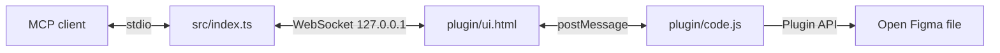

# figma-mcp-unchained documentation

`figma-mcp-unchained` is a local stdio MCP server that exposes 16 tools and one prompt against the Figma Desktop file where the bridge plugin is open:

- Canvas: `use_figma`, `get_screenshot`, `get_metadata`
- Design context: `get_design_context`, `get_variable_defs`, `get_motion_context`
- FigJam: `get_figjam`, `generate_diagram`
- Assets: `download_assets`, `upload_assets`, `export_video`
- Design system: `get_libraries`, `search_design_system`
- Shaders: `list_shaders`, `get_shader`, `list_file_shaders`
- Prompt: `create_design_system_rules`

The plugin can be loaded in Design, FigJam and Slides files. See [tool parity](official-tool-parity.md) for local approximations and deliberately blocked cloud capabilities.

It does not use the Figma cloud API and needs no Figma token.

## Contents

| Guide | Description |
|---|---|
| [Setup](setup.md) | Install, run, pair the plugin, register an MCP client |
| [Bridge](bridge.md) | Transport, protocol, routing, token and security details |
| [Tools](tools.md) | Tool inputs, return shapes and examples |
| [Troubleshooting](troubleshooting.md) | Common errors and fixes |

## Quick start

```bash
npm ci
npm run build
```

Register `<path-to-repo>/dist/index.js` with your MCP client. In Figma Desktop, import `plugin/manifest.json`, run **Figma MCP Unchained**, paste the token from `~/.figma-mcp-unchained/token`, and press **Save**.

## Architecture



The WebSocket carries commands and results in both directions. The plugin can fall back to polling `GET /commands` and posting results to `POST /results/:id` when a WebSocket is unavailable.
