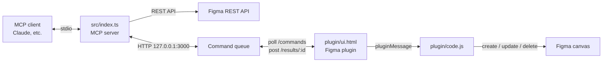

# figma-bridge Documentation

A Model Context Protocol (MCP) server that exposes Figma read tools over stdio and
controlled edits through a local Figma plugin bridge.

## Contents

| Guide | Description |
|---|---|
| [Setup](setup.md) | Install, configure the token, register the server with an MCP client |
| [Tools Reference](tools.md) | Every MCP tool, its inputs and example payloads |
| [Figma Bridge](bridge.md) | How to use the bridge for live edits and how the protocol works |
| [Troubleshooting](troubleshooting.md) | Common errors and how to fix them |

## Quick Start

```bash
npm install
cp .env.example .env   # add your FIGMA_PERSONAL_ACCESS_TOKEN
npm start
```

Then register the server with your MCP client (see [Setup](setup.md)).

For edits, also install and run the local plugin (see [Figma Bridge](bridge.md)).

## Architecture



- **Reads** (`figma_get_file`, `figma_get_nodes`, `figma_render_nodes`) go straight to
  the Figma REST API.
- **Writes** (`figma_edit`) are queued and executed by the plugin inside the file you
  have open in the Figma desktop app.
