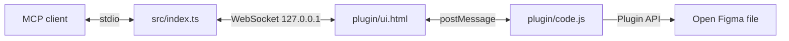

# figma-bridge documentation

`figma-bridge` is a local stdio MCP server that exposes three tools against the Figma Desktop file where the bridge plugin is open:

- `use_figma`
- `get_screenshot`
- `get_metadata`

It does not use the Figma cloud API and needs no Figma token.

## Contents

| Guide | Description |
|---|---|
| [Setup](setup.md) | Install, run, pair the plugin, register an MCP client |
| [Bridge](bridge.md) | Transport, protocol, routing, token and security details |
| [Tools](tools.md) | Tool inputs, return shapes and examples |
| [Troubleshooting](troubleshooting.md) | Common errors and fixes |

## Quick start

```bash
npm ci
npm run build
```

Register `<path-to-repo>/dist/index.js` with your MCP client. In Figma Desktop, import `plugin/manifest.json`, run **Local Figma Bridge**, paste the token from `~/.figma-bridge/token`, and press **Save**.

## Architecture



The WebSocket carries commands and results in both directions. The plugin can fall back to polling `GET /commands` and posting results to `POST /results/:id` when a WebSocket is unavailable.
