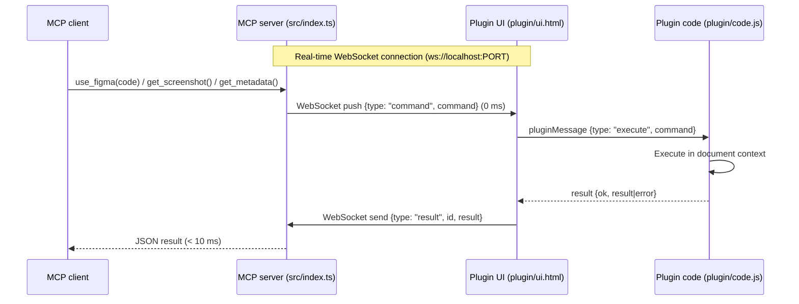

# Figma Bridge

The Figma REST API is read-only for design nodes. The local bridge lets Canvas tools (`use_figma`, `get_screenshot`, `get_metadata`) execute in the Figma document context in real time: the MCP server dispatches commands via WebSocket push (with HTTP fallback), and a local Figma plugin executes them inside the file you have open.

## How it works

1. When the plugin window opens, it connects via real-time WebSocket (`ws://localhost:<PORT>`).
2. Canvas tools push commands over WebSocket instantly (0 ms latency).
3. The plugin sandbox (`plugin/code.js`) executes the request in the document context and streams the result back immediately.
4. If WebSockets are unavailable or disconnected, the system automatically falls back to HTTP polling.

## Run the bridge

1. Start the MCP server (via your MCP client, or `npm start` for testing).
2. In the **Figma desktop app**, open the target file.
3. **Plugins → Development → Import plugin from manifest…** and select `plugin/manifest.json`.
4. Run **Plugins → Development → Local Figma Bridge**.
5. Leave the plugin window open while editing. It shows a green status dot when connected.

Commands apply to the **currently open file** in the desktop app.

## Configuration

| Server (`.env`) | Plugin | Default |
|---|---|---|
| `PORT` | Auto-detected in plugin UI | `3000` (auto-increments if port is in use) |
| `FIGMA_BRIDGE_TOKEN` | Stored in plugin clientStorage | `local-development-token` |

- The server binds to `127.0.0.1` by default (override with `FIGMA_BRIDGE_HOST`; non-loopback binds log a warning).
- CORS is an allowlist (`null` for the plugin iframe plus loopback origins), never `*`.
- If port `3000` (or `PORT`) is busy, the server automatically increments and binds to the next available port (e.g. `3001`). The active port is saved in `.bridge-port`.
- The plugin UI automatically scans candidate ports (3000–3010) if connection is lost.
- The token is passed via `token` query parameter or `X-Bridge-Token` header.

## Supported Canvas Bridge Commands

Executed by `plugin/code.js` against the open file:

| Command | Effect |
|---|---|
| `use_figma` | Executes JavaScript code via Plugin API with top-level `await` and returns serializable data |
| `get_node_tree` | Traverses node tree hierarchy with depth limiting (defaults to `figma.currentPage`) |
| `export_node` | Exports node or current selection as base64 PNG/JPG/SVG/PDF |
| `parallel_snapshot` | Serializes a node subtree + page context for PARALLEL |
| `parallel_preview` | Clones the node, applies validated changes, exports a PNG, removes the clone |
| `parallel_apply` | Clones the node, applies validated changes, keeps the duplicate and returns its id |
| `parallel_discard` | Removes a node created by `parallel_apply` |

Full field tables and payloads: [Tools Reference](tools.md#canvas-bridge-tools-local-bridge). The PARALLEL commands are also surfaced as MCP tools — see [PARALLEL](parallel.md).

## Limitations

- One file at a time: commands run in whatever file is active in the desktop app.
- The plugin window must stay open; closing it disconnects the WebSocket.
- The queue is in memory — restarting the server discards pending commands.

## See also

- [Tools Reference](tools.md) — Comprehensive parameter and schema guide
- [Troubleshooting](troubleshooting.md) — Diagnosing connection, timing, and canvas issues
