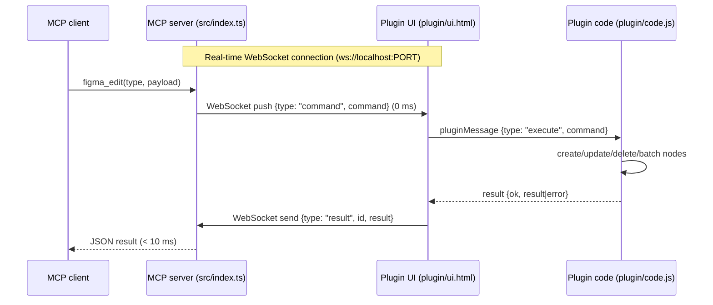

# Figma Bridge

The Figma REST API is read-only for design nodes. The bridge lets `figma_edit` run real
edits: the MCP server dispatches commands via real-time WebSocket push (with HTTP polling fallback),
and a local Figma plugin executes them inside the file you have open.

## How it works



1. When the plugin window opens, it connects via real-time WebSocket (`ws://localhost:<PORT>`).
2. `figma_edit` pushes commands over WebSocket instantly (0 ms latency).
3. The plugin sandbox (`plugin/code.js`) applies the changes and streams the result back immediately.
4. If WebSockets are unavailable or disconnected, the system automatically falls back to HTTP polling.


## Run the bridge

1. Start the MCP server (via your MCP client, or `npm start` for testing).
2. In the **Figma desktop app**, open the target file.
3. **Plugins → Development → Import plugin from manifest…** and select
   `plugin/manifest.json`.
4. Run **Plugins → Development → Local Figma MCP Bridge**.
5. Leave the plugin window open while editing. It shows `Waiting for MCP commands...`
   when connected.

Then call the `figma_edit` tool from your MCP client. Edits apply to the **currently
open page** unless you pass a `parentId`.

## Configuration

| Server (`.env`) | Plugin | Default |
|---|---|---|
| `PORT` | Configured / auto-detected in plugin UI | `3000` (auto-increments if port is in use) |
| `FIGMA_BRIDGE_TOKEN` | Bridge token field in the plugin window | `local-development-token` |

- The server listens on `127.0.0.1` only; it is not reachable from the network.
- If port `3000` (or `PORT`) is busy, the server automatically increments and binds to the next available port (e.g. `3001`).
- The plugin UI includes an **Auto-detect Port** button and automatically searches ports 3000–3010 if connection is lost.
- The token is sent in the `X-Bridge-Token` header. A mismatch returns `401`.

## HTTP protocol

Endpoints are local to `http://127.0.0.1:PORT`.

| Method | Path | Behavior |
|---|---|---|
| `GET` | `/health` | Bridge discovery and status check (returns `{ok, name, port, authenticated}`) |
| `GET` | `/commands` | Dequeues and returns the next command, or `null` (requires `X-Bridge-Token`) |
| `POST` | `/results/:id` | Delivers `{ok, result?, error?}` for a command; `204` on success (requires `X-Bridge-Token`) |

Command object:

```json
{
  "id": "0f9c2f0e-...-uuid",
  "type": "create_frame",
  "payload": { "name": "Dashboard", "width": 1440, "height": 900 }
}
```

Manual smoke test:

```bash
curl -H "X-Bridge-Token: local-development-token" http://127.0.0.1:3000/commands
```

`null` means the queue is empty (the bridge is up and authenticated).

## Supported commands

Executed by `plugin/code.js` against the open file:

| Command | Effect |
|---|---|
| `create_frame` | Creates a frame on the current page (or under `parentId`) |
| `create_text` | Creates a text node |
| `update_node` | Updates `name`, `x`, `y`, `width`, `height`, `characters` |
| `delete_node` | Removes the node |

Full field tables and payloads: [Tools Reference → `figma_edit`](tools.md#figma_edit).

## Limitations

- One file at a time: commands run in whatever file is open in the desktop app.
- The plugin window must stay open; closing it stops polling and edits time out.
- The queue is in memory — restarting the server discards pending commands.
- Supported operations are only the four command types above (no styles, components,
  autolayout, etc.).
- Edits are applied to the current page by default; use `parentId` to target a frame.

## See also

- [Troubleshooting](troubleshooting.md) for connection and timeout issues
