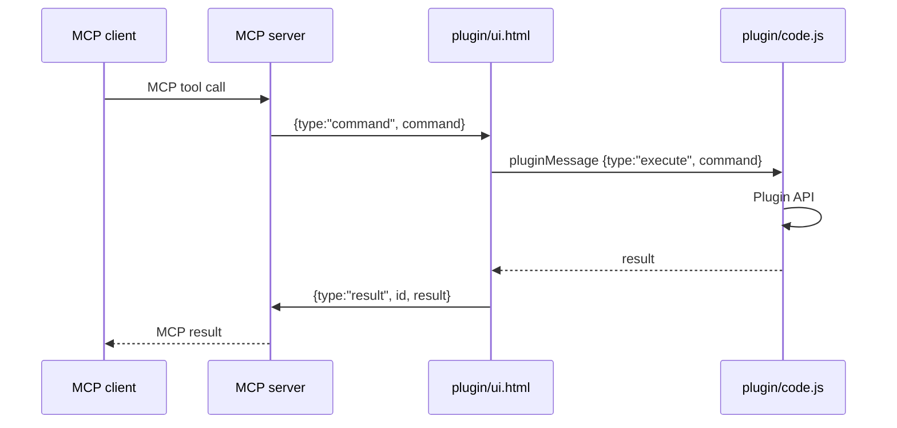

# Bridge protocol

The MCP server owns a loopback HTTP server and a WebSocket server. A Figma Desktop plugin connects to it, receives commands, executes them through the Plugin API and returns results.

## Connection



- The server binds to `127.0.0.1` and accepts `Host` headers for `127.0.0.1` or `localhost`, with or without a port.
- The WebSocket URL is `ws://127.0.0.1:<PORT>?token=<token>`.
- A WebSocket upgrade with an `Origin` header is rejected unless the value is `null` or a loopback HTTP(S) origin.
- The plugin scans ports `3000`–`3010` and `31337` when it cannot connect to the saved port.

## Token

- If `FIGMA_MCP_UNCHAINED_TOKEN` is set, the server uses it.
- Otherwise the server reads `~/.figma-mcp-unchained/token`. If the file does not exist, it generates 32 random bytes, writes the file with mode `0600`, and logs only the path.
- The plugin stores the token in Figma `clientStorage` and sends it as the WebSocket `token` query parameter or the `X-Bridge-Token` header.

## Sessions and routing

On connect, the plugin sends:

```json
{ "type": "hello", "sessionId": "…", "fileName": "…", "pageName": "…" }
```

The server tracks every connected plugin window.

- One connected plugin: commands go to it.
- Several connected plugins: every tool requires the optional `file` argument. It matches either `fileName` or `sessionId`. Without it, the tool returns an error listing the candidates.
- No connected plugin and no active polling plugin: tools fail immediately with a "no plugin connected" error.

Only one command is sent to each selected plugin. A command is never broadcast.

## Commands

| Command | Sent by | Effect |
|---|---|---|
| `use_figma` | `use_figma` | Runs the supplied JavaScript in the plugin sandbox and returns its value |
| `export_node` | `get_screenshot` | Exports the target node or page as base64 PNG, JPG, SVG or PDF |
| `get_node_tree` | `get_metadata` | Serializes the target node subtree as JSON or XML |
| `get_variable_defs` | `get_variable_defs` | Resolves variables and styles used by a subtree |
| `get_design_context` | `get_design_context` | Returns structured design data plus an optional PNG |
| `get_figjam` | `get_figjam` | Returns FigJam XML and bounded node images |
| `get_motion_context` | `get_motion_context` | Reads animation data and generates CSS/Motion snippets |
| `download_assets` | `download_assets` | Exports renders, original images and SVG assets |
| `upload_assets` | `upload_assets` | Creates image fills and SVG layers from uploaded bytes |
| `get_libraries` | `get_libraries` | Lists enabled library variables and local assets |
| `search_design_system` | `search_design_system` | Searches local components, variables and styles |
| `list_shaders`, `get_shader`, `list_file_shaders` | matching tools | Reads shader metadata and file usage |
| `generate_diagram` | `generate_diagram` | Creates FigJam shapes and connectors from Mermaid |
| `export_video` | `export_video` | Exports a top-level animated frame or slide as MP4 |

## Timeouts and late results

- Each command carries an expiry based on `FIGMA_COMMAND_TIMEOUT_MS`.
- On timeout, the server removes the command from the queue, drops the waiter and sends a `cancel` message to the plugin.
- The plugin ignores expired or cancelled commands and suppresses their late results.
- A command that had no connected plugin never enters the queue.
- Results for unknown or expired ids are ignored.

## Polling fallback

If the WebSocket is unavailable, the plugin:

1. Polls `GET /commands` with `X-Bridge-Token`.
2. Executes each returned command.
3. Posts the result to `POST /results/:id` with `X-Bridge-Token`.

Both routes require the token. `GET /health` is the only unauthenticated route and reports liveness and plugin connectivity, not auth state.

## Security notes

- The bridge executes arbitrary JavaScript inside the open Figma file and can read local paths supplied to `upload_assets`. Keep it loopback-only and only pass files you intend to upload.
- The token is compared without early exit and is never logged.
- CORS is an allowlist: `null` (the plugin iframe) and loopback origins. It is never `*`.
- The server rejects HTTP and WebSocket requests whose `Host` is not `127.0.0.1` or `localhost`.
