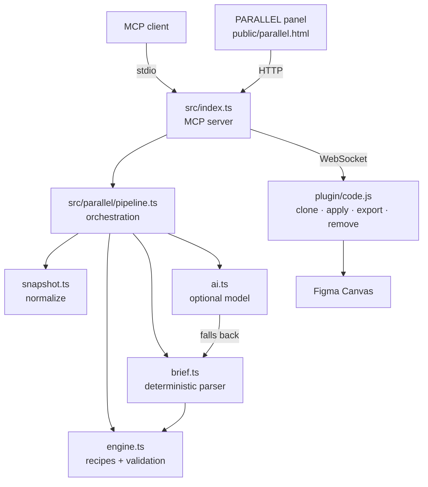

# PARALLEL

Visual exploration for Figma components: inspect a selection, generate three
distinct directions, compare them side by side, and apply one to a **duplicate**
— never to the original.

```
select a component → inspect → generate 3 directions → render previews
                   → compare → choose → confirm → apply to a duplicate → verify
```

| Direction | Intent | Typical recipes |
|---|---|---|
| **Refine** | Improve the design, keep its character | `rhythm.grid`, `radius.align`, `type.contrast`, `contrast.readability` |
| **Reinterpret** | Different visual language, same purpose | `surface.tint`, `radius.language`, `type.tracking`, `density.scale` |
| **Mutate** | Experimental push, explicit about constraints | `surface.invert`, `radius.language`, `type.tracking`, `contrast.readability` |

Each direction is a **composition of named recipes** — small, capability-aware
builders that each express one design idea (tighten the grid, shift the corner
language, re-tone the surfaces…). Recipes run in order and are de-duplicated by
`(kind, targetId)`, so later recipes cannot silently override earlier ones.

Every direction reports which constraints it **keeps** and which it **pushes**.

## Two interfaces, one pipeline

1. **MCP tools** — `parallel_explore`, `parallel_brief`, `parallel_apply`,
   `parallel_discard`. Agent-driven; previews are returned as image blocks.
2. **PARALLEL panel** — a local page served by the bridge at
   `http://127.0.0.1:<PORT>/parallel`. Side-by-side comparison with explicit
   confirmation before anything is applied.

Both call the same pipeline (`src/parallel/pipeline.ts`).

## Architecture



- `src/parallel/types.ts` — shared contracts (`ComponentSnapshot`, `Variation`,
  `VariationPreview`, `AppliedVariation`, `ExplorationBrief`, `VisualPrinciple`).
- `src/parallel/snapshot.ts` — plugin tree → normalized snapshot with
  per-node `capabilities` (what may safely change).
- `src/parallel/engine.ts` — **pure** recipe engine. `RECIPES` is the catalogue
  of named transformations; `composeRecipes` builds a direction and
  `validateChanges` drops anything a node cannot support. No Figma access, fully
  fixture-testable.
- `src/parallel/brief.ts` — deterministic brief parser. `PRINCIPLE_RULES` maps
  keywords to recipes; `parseBrief` and `generateBriefVariations` are always
  available and need no credentials.
- `src/parallel/ai.ts` — optional model interpretation. Off by default;
  `interpretBrief` falls back to the deterministic parser on any failure and
  whitelists model output to recipe ids.
- `src/parallel/pipeline.ts` — orchestrates inspect → generate → render, exposes
  `exploreWithBrief` / `previewBrief`, and owns the variation registry used for
  safe application.
- `src/parallel/color.ts` — colour maths (contrast, luminance, hue, mix).
- `src/ui/panel.ts` + `public/parallel.html` — the panel.
- `plugin/code.js` — deterministic commands: `parallel_snapshot`,
  `parallel_preview`, `parallel_apply`, `parallel_discard`.

The bridge also exposes `POST /parallel/brief` (run guided exploration),
`POST /parallel/brief/interpret` (parse a brief without touching the document),
and `GET /parallel/state`, which now reports whether a model is configured
(`aiConfigured`).

## Guided exploration

`parallel_brief` adds a second way to choose directions: describe what you want
in words, optionally with a reference image. There are two paths, and the tool
is explicit about which one ran.

**Deterministic (default).** `brief.ts` lowercases the prompt, scores it against
`PRINCIPLE_RULES` (for example *airy*, *editorial*, *dark mode*, *sharp*,
*monochrome*), and maps matched principles onto recipes the engine already has.
Each principle becomes one brief-directed direction, composed from its recipes
plus the readability safety net and validated like any other direction. Terms
that match nothing are returned in `unsupported` and surfaced as warnings; they
are never guessed at.

**Optional model.** If `PARALLEL_AI_PROVIDER` and a key are configured, `ai.ts`
asks an OpenAI-compatible chat endpoint to extract 1–4 principles. Its response
is treated as untrusted: `sanitisePrinciples` drops unknown recipe ids, clamps
parameter types, and whitelists the result to `RECIPES`. The model returns
principle → recipe selections only — never code, node ids or raw Figma
properties.

**Honesty and fallback.** When no provider is configured, `interpretBrief`
returns the deterministic brief with `interpretedBy: "deterministic"` and a
note; a reference image alone cannot be read without a model, so the note says
so rather than inventing an interpretation. If the model errors, times out or
returns nothing usable, the deterministic result is returned with the reason in
`note`. Either way the brief is included in the result and its notes are added
to `warnings`.

## Why applying is safe

- **The original is never mutated.** Preview and apply both operate on
  `node.clone()`; previews remove the clone immediately after rendering.
- **Clients cannot inject mutations.** `parallel_apply` takes only a
  variation id. The server looks the variation up in its registry and applies
  the changes *it* generated. The generic `/execute` alias refuses `parallel_*`
  command types outright, so there is no side door that skips the registry.
- **Changes are validated twice.** Once when generated, once before dispatch
  (`validateChanges`), against the snapshot captured at generation time.
- **Briefs and models can only choose recipes.** A brief is reduced to
  `VisualPrinciple`s whose recipes are filtered against `RECIPES`; model output
  is whitelisted the same way. Neither can emit code, node ids or raw Figma
  properties, so neither can escape the engine's contract.
- **Unsupported edits are rejected, not guessed.** Anything a node cannot
  support is dropped with a reason.
- **Child ids are remapped.** A clone has new descendant ids; the plugin maps
  old → new so edits land on the duplicate, never the source.
- **Partial failures are surfaced.** A single failed property becomes a warning;
  the rest still apply and the created node id is returned.
- **Discard is first-class and scoped.** `parallel_discard` only removes a node
  the server itself recorded creating; an id it did not create (including your
  original component) is refused rather than deleted.

## Run

```bash
npm install
cp .env.example .env            # set FIGMA_PERSONAL_ACCESS_TOKEN (REST tools only)
npm start                       # MCP server + bridge

# In Figma Desktop: Plugins → Development → Import plugin from manifest…
#   → plugin/manifest.json, then run "Local Figma Bridge", leave it open.
```

Open the panel: <http://127.0.0.1:3000/parallel?token=local-development-token>
(The token may also be sent as an `X-Bridge-Token` header; the query form exists because browsers cannot attach headers to a top-level navigation.)

> The bridge binds to **127.0.0.1** only. If port 3000 is busy it increments
> (3001, 3002, …) and the active port is written to `.bridge-port`.

## Verify

```bash
npm run typecheck      # src, strict
npm test               # 69 tests: units, plugin node ops, real HTTP/WS integration
npm run parallel:check # live: explores the current selection, writes PNGs to parallel-out/
npm run parallel:check -- --apply   # also applies the mutate direction, then discards it
```

Test layers:

| Layer | What it proves |
|---|---|
| `tests/*.test.ts` (units) | normalization, engine rules, validation, pipeline states |
| `tests/plugin.test.ts` | the **real** `plugin/code.js` node ops against a fake Figma API: original untouched, id remapping, partial failures, discard |
| `tests/bridge.test.ts` | the **real** HTTP + WebSocket bridge with a mock plugin: token gating, CORS, panel, full loop, timeouts |
| `npm run parallel:check` | the pipeline against a **live** Figma document (needs the plugin open) |

## Demo script (interview, ~4 min)

1. **Framing.** "Exploring alternatives in Figma is manual and destructive.
   PARALLEL makes it systematic and reversible."
2. **Set up.** Show `.env`, `npm start`, then the green plugin dot in Figma.
3. **Pick a real component.** Select a dashboard card or command palette.
4. **Open the panel** at `http://127.0.0.1:3000/parallel?token=local-development-token`. Point out the
   connection indicator and the "original — untouched" reference.
5. **Explore.** Press *Explore selection*. Call out the snapshot chips
   (type, size, node count) and the three cards appearing.
6. **Read the work.** For each card: what changed, what it keeps, what it pushes.
   Emphasise that Refine is subtle, Reinterpret changes the language, Mutate
   challenges the assumptions.
7. **Guide it with a brief.** Type a direction into the brief bar — e.g.
   *"airy and editorial, sharp corners, cool tones"* — press *What I understood*
   to show the extracted principles and the recipes they map to, then *Explore
   with brief* to add brief-directed directions alongside the three standard
   ones. Point out that each brief card is badged **BRIEF**, and that no AI
   provider was needed — the built-in parser handled it and said so. (The same
   flow is available to agents through `parallel_brief`.)
8. **Apply.** Press *Apply to duplicate* → the confirmation dialog → confirm.
   Show the toast with the new node id. Both components are visible in Figma.
9. **Prove the original is safe.** Compare the original against the duplicate.
   Press *Discard duplicate* — the node disappears, the original is untouched.
10. **Close.** "Same loop is available to agents through four MCP tools."

### Fallback if Figma is unavailable

`npm run parallel:check` writes `parallel-out/original.png`,
`refine.png`, `reinterpret.png`, `mutate.png`. Walk through those and the
`parallel_explore` MCP output. Then run `npm test` to show the 69 passing
checks, including the plugin node-operations suite.

## Limitations (honest)

- **Previews are transient document nodes.** Each preview clones the component
  next to it, exports at 2×, and removes the clone within milliseconds. Offscreen
  rendering is not used, so there is a brief flash in Figma.
- **Guided exploration is bounded, not generative.** A brief or reference image
  only selects from the existing recipe catalogue. The optional model cannot
  invent transformations, emit code or touch the document; without a model, a
  deterministic keyword parser handles text and cannot read images.
- **A small, supported property set.** The recipes currently emit **fill**,
  **corner radius**, **stroke colour/weight**, **item spacing**, **padding**,
  **font size** and **letter spacing**. The plugin can also apply font style and
  opacity, but no recipe uses them yet. Gradients, effects and vector geometry
  are out of scope.
- **Contrast correction judges the nearest filled ancestor, composited.**
  Translucent text is measured as it actually renders (composited over its
  surface), and a fix is emitted opaque so it truly clears 4.5:1. Unusual
  nesting, image or gradient backgrounds can still fool the estimate.
- **One file at a time.** Commands run in whichever file has the plugin open.
- **The registry is in memory.** Restarting the server invalidates variation
  ids; re-run explore.
- **Not production-hardened.** The bridge executes code inside Figma. Keep it
  loopback-only.

## Security posture

- Binds to `127.0.0.1` by default (`FIGMA_BRIDGE_HOST` overrides; non-loopback
  binds log a loud warning).
- CORS is an allowlist (loopback origins + `null` for the plugin iframe), never
  `*`.
- The shared bridge token is compared in constant time and never logged; the
  Figma personal access token is never logged or sent to the plugin.
- The macOS service installer no longer embeds `FIGMA_PERSONAL_ACCESS_TOKEN` or
  `FIGMA_BRIDGE_TOKEN` in the launchd plist. The server loads `.env` via dotenv
  from its working directory, and the plist (which contains no secrets) is
  written `chmod 600`.
- Starting with `NODE_ENV=production` and the default token throws.
- `/health` reports liveness and plugin connectivity, not auth state.
- The panel injects the token because the server is loopback-only; if you bind
  elsewhere, put your own auth in front of it.
